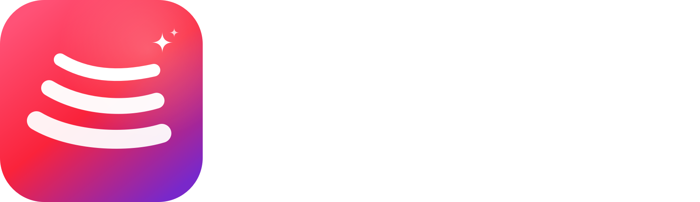

<div align="center">

<br/>
<br/>



# LuminaChord

### Multi-Platform YouTube Music & Local Audio Client with Cross-Device Sync

By [**@Maizu28**](https://github.com/Maizu28) · Forked from [**BitChord**](https://github.com/kushagrasinghx/BitChord) by [**@kushagrasinghx**](https://github.com/kushagrasinghx)

<br/>

> [!NOTE]
> **Fork & Upstream Credit Notice:**
> **LuminaChord** is an independent derivative project / fork built upon [**BitChord**](https://github.com/kushagrasinghx/BitChord), originally created by [**kushagrasinghx**](https://github.com/kushagrasinghx) and the BitChord contributors.
> All core foundation credit belongs to the original BitChord project. Per **GNU GPL v3.0**, LuminaChord documents its modifications clearly and links directly to the [upstream repository](https://github.com/kushagrasinghx/BitChord).

<br/>

[**What's New in LuminaChord**](#luminachord-features) · [**Core Features**](#core-features) · [**Download & Build**](#download--build) · [**Credits & Upstream**](#credits--upstream-attribution) · [**License**](#license)

<br/>

</div>

> [!IMPORTANT]
> LuminaChord is an independent, community-maintained third-party client licensed under GPLv3. It is **not** affiliated with, endorsed by, or connected to Google LLC, YouTube Music, Spotify, Discord, or any third-party content providers.

---

<div align="center">


</div>

## <a id="luminachord-features"></a>What's Added & Customized in LuminaChord

Beyond the core [BitChord](https://github.com/kushagrasinghx/BitChord) codebase, **LuminaChord** focuses on seamless continuity between **Android** and **Windows Desktop**:

- **LuminaChord Sync (Desktop ↔ Mobile Continuity)**
  - **Fast Pairing**: Connect Android and Windows via Wi-Fi LAN auto-discovery, in-app camera QR Code scanner, or USB ADB tunnel (`127.0.0.1`).
  - **Bidirectional Local Music Merge**: Compare and merge local audio libraries between Windows and Android (`Music/LuminaChord`) over LAN or USB.
  - **Seamless Audio Output Switching (`Desktop ↔ Mobile`)**: Switch playback output directly inside the Player **Audio Output** sheet, Android's *LuminaChord for Desktop* screen, or Windows' *Hubungkan dengan Mobile* menu — handing off the active track, queue, shuffle/repeat state, and playback timestamp.
  - **Cross-Device Playback Control**: Control play/pause, skip, 60fps RTT-compensated seekbar, shuffle, repeat, favorites, and Desktop volume directly from Android (or inspect/control Mobile playback from Windows).
  - **Real-Time Synced Lyrics on Mobile**: Play audio on Windows Desktop while reading live word/line-synced lyrics on Android (including tap-a-line to seek PC).
  - **Remote Desktop Queue Management**: View, jump to, reorder, enqueue (*Play Next* / *Add to Queue*), remove, or clear Desktop's playback queue straight from Android.
- **Android Home Screen Lyric Widgets**: Two **Liquid Glass** widget variants — **4×2 Full Player & Lyric** and **4×1 Lyric Only**.
- **Listen Together Cross-Platform**: Synchronized listening rooms working seamlessly across Android Mobile and Windows Desktop (using the default relay or a configurable custom/self-hosted server).
- **Windows Installer Packaging**: Native Windows Inno Setup installer (`LuminaChord-Windows-x64-Setup.exe`) generated via `:desktopApp:windowsInstaller`.

---

## <a id="core-features"></a>Core Features (Inherited from BitChord)

<table>
  <tr>
    <td width="50%" valign="top">

#### Playback & Audio
- **Search, browse & play** music and videos via YouTube Music.
- **Hi-Res lossless audio** (FLAC/ALAC) from pluggable module sources, with YouTube Music fallback.
- **Gapless playback & crossfade** (0–12s) and **Automix** DJ-style beat-matched transitions.
- **Bit-perfect USB DAC exclusive output** on Android, preserving source sample rate and bit depth.
- **Local library integration** and **offline downloads** with embedded tags/artwork.
- **Playback tweaks**: speed control (0.5×–2.0×), skip silence, sleep timer, and system equalizer integration.

#### Connectivity & Ecosystem
- **Google / YouTube Music account sign-in** for library & personalized feeds.
- **Spotify playlist & Liked Songs import**.
- **Discord Rich Presence** with live track metadata and progress.
- **Scrobbling** to **Last.fm** and **ListenBrainz**.
- **Multi-module Kotlin architecture**: Android (`:app`), Desktop (`:desktopApp`), Android TV (`:tv`), and Wear OS (`:wearos`).

    </td>
    <td width="50%" valign="top">

#### Visual & Lyrics Experience
- **Animated album canvas** and dynamic artwork-extracted Material 3 palettes.
- **Liquid Glass & frosted-glass UI** surfaces (using Haze backdrop sampling on Android and Compose Multiplatform on Desktop).
- **Apple-like synced lyrics animation** with word/syllable-level timing, translation, and romanization.
- **Multi-provider lyrics resolution**: `lrc.red`, `BiniLyrics`, `BetterLyrics`, `PaxSenix`, `LyricsPlus`, `SimpMusic`, `Unison`, `Megalobiz`, `KuGou`, `LRCLIB`, `Musixmatch`, and `Genius`.
- **Stats for nerds**: live codec, bit depth, sample rate, cache source, and telemetry overlays.

    </td>
  </tr>
</table>

---

## <a id="download--build"></a>Download & Build

### Releases
Pre-built Android APKs and Windows installers for this fork are published on the [**LuminaChord Releases**](https://github.com/Maizu28/LuminaChord/releases) page:
- **Android**: `app-prod-arm64-v8a-debug/release.apk` or `universal` APK
- **Windows (x64)**: `LuminaChord-Windows-x64-Setup.exe`

*(Looking for the original upstream releases? Visit [**kushagrasinghx/BitChord Releases**](https://github.com/kushagrasinghx/BitChord/releases).)*

### Building from Source (Java 21)

```bash
# Run Desktop app (Windows / macOS / Linux)
./gradlew :desktopApp:run

# Build Windows Setup Installer (.exe) using Inno Setup
./gradlew :desktopApp:windowsInstaller

# Build Android APK (requires Android SDK configured in local.properties / ANDROID_HOME)
./gradlew :app:assembleProdDebug
```

See [DESKTOP.md](DESKTOP.md) for platform-specific desktop setup and packaging instructions.

---

## <a id="credits--upstream-attribution"></a>Credits & Upstream Attribution

**LuminaChord** exists thanks to open-source work by the original **BitChord** author and ecosystem contributors:

- **Original Project & Creator**: [**BitChord**](https://github.com/kushagrasinghx/BitChord) by [**@kushagrasinghx**](https://github.com/kushagrasinghx) and all [upstream BitChord contributors](MAINTAINERS.md).
- **Synced Lyrics Animation Reference**: [binimum/am-lyrics](https://github.com/binimum/am-lyrics)
- **USB Bit-Perfect Audio Reference**: [Mornye](https://github.com/mornyeapp/Mornye)
- **Lyrics Providers**: [lrc.red](https://lrc.red), [BiniLyrics](https://github.com/binimum), [BetterLyrics](https://github.com/better-lyrics/better-lyrics), [PaxSenix](https://lyrics.paxsenix.org), [LyricsPlus](https://github.com/ibratabian17/YouLyPlus), [SimpMusic](https://github.com/maxrave-dev/SimpMusic), [Unison](https://unison.boidu.dev), [Megalobiz](https://www.megalobiz.com), [KuGou](https://www.kugou.com), [LRCLIB](https://lrclib.net), [Musixmatch](https://www.musixmatch.com), and [Genius](https://genius.com).

If you appreciate the original core player and want to follow or support the upstream BitChord author directly, please visit [**github.com/kushagrasinghx/BitChord**](https://github.com/kushagrasinghx/BitChord).

---

## Contributing

Bug reports, ideas, and pull requests for LuminaChord-specific features can be opened on [**Maizu28/LuminaChord**](https://github.com/Maizu28/LuminaChord). Please also check [CONTRIBUTING.md](CONTRIBUTING.md) and [CODE_OF_CONDUCT.md](CODE_OF_CONDUCT.md) when contributing.

---

## <a id="disclaimer"></a>Disclaimer & Legal Notice

LuminaChord is an independent, non-commercial derivative audio player and third-party client maintained at [**Maizu28/LuminaChord**](https://github.com/Maizu28/LuminaChord). It is **not** associated with Google LLC, YouTube Music, Spotify, Discord, Telegram, or any of their parent companies.

* **No Media Hosting:** LuminaChord does not host, upload, or distribute copyrighted music files. It operates strictly as a client for local device storage, LAN sync, or user-initiated streaming from third-party APIs.
* **Fair Use & Responsibility:** Users are solely responsible for ensuring their use complies with local laws and third-party Terms of Service.
* **No Warranty:** Distributed strictly "AS IS" without warranty of any kind, under the terms of the GNU General Public License v3.0.

---

## <a id="license"></a>License

Both upstream **BitChord** and this derivative project **LuminaChord** are licensed under the **GNU General Public License v3.0 (GPLv3)**.
In accordance with GPLv3 Section 5, this notice clearly states that LuminaChord contains modifications and extensions on top of [BitChord](https://github.com/kushagrasinghx/BitChord), and full source code remains available under the same GPLv3 license. See [LICENSE](LICENSE) for complete terms.
